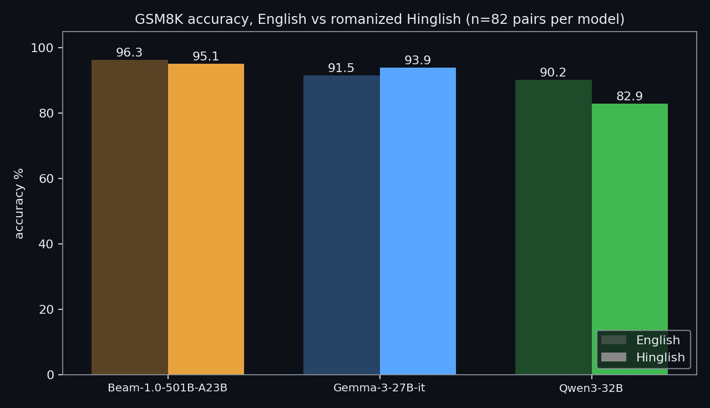
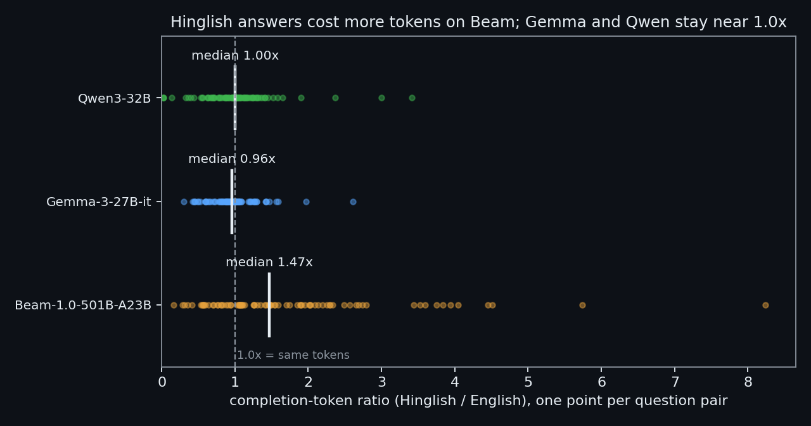

# HinglishBench

**Does answering in Hinglish cost a model more than answering in English? We measured it.**

HinglishBench is a parallel English/Hinglish reasoning evaluation for open LLMs. We took 82 GSM8K math problems, had Beam translate them into romanized Hinglish, and asked three models the exact same questions in both languages with the exact same prompt. Then we compared two things: how often each model is right, and how many tokens it spends.

- **Dataset + per-item predictions:** https://huggingface.co/datasets/MaybeSomeone19/hinglishbench
- **Explorer (leaderboard + every raw answer):** https://huggingface.co/spaces/MaybeSomeone19/hinglishbench

## What we found, in two pictures

**1. Accuracy: Beam holds up in Hinglish. Qwen does not.**

Beam scores almost the same in both languages (96.3% English, 95.1% Hinglish). Gemma is slightly *better* in Hinglish. Qwen drops 7 points.

**2. Cost: Beam spends ~1.5x more tokens to say the same thing in Hinglish.**

Each dot is one question pair. Beam's median Hinglish/English completion-token ratio is **1.47x**; Gemma and Qwen sit at ~1x. The same pattern shows up on two more datasets we built (1.58x on 100 tiered pairs, 1.30x on 309 reverse-direction pairs), and the two prompt variants we tried did not remove it. Details in the dataset card.

## Headline numbers (82 GSM8K pairs, zero-shot, single run)

| Model | English | Hinglish | Median token tax (HI/EN) |
|---|---|---|---|
| Beam-1.0-501B-A23B (effort=low) | 96.3% | 95.1% | 1.47x |
| Gemma-3-27B-it | 91.5% | 93.9% | 0.96x |
| Qwen3-32B | 90.2% | 82.9% | 1.00x |

Three models, one sample per cell; observed values are reported without claiming statistical significance. Negative results (prompting and effort do not remove Beam's tax in these runs) are in the dataset card.

## Read this before citing it

- **Small and single-run:** three models, 82 pairs, one sample per cell. Treat differences as observed values, not proven effects.
- **Automated checks:** translation quality and answer grading are automated; preparation checks were AI-assisted, not independent human validation.
- **Reverse-direction set is easier** and Beam-authored, with near-saturated Beam accuracy - don't compare it against the main set.
- The exact median definition: upper-middle element of the sorted per-pair ratios (analyze.py, `sorted(...)[n//2]`), 1.4706 for Beam, reported as 1.47x.

## What is here

- `scripts/translate_gsm8k.py` - GSM8K EN -> romanized Hinglish translation via Beam, with automated numeric-preservation check
- `scripts/run_bench.py` - resumable benchmark runner (fair CoT prompt, exact-match grading on the final line, token accounting); `BEAM_EFFORT` env var sets Beam's `reasoning_effort`
- `scripts/run_all_models.sh`, `scripts/run_all_v2.sh`, `scripts/run_beam_medium.sh` - the 3-model matrix runs (low effort) and the Beam medium-effort run
- `scripts/mitigation.py` - "think in English" mitigation experiment
- `scripts/gen_hinglish_dataset.py` - Beam-authored Hinglish reasoning data: generate -> automated checks -> dedup -> self-consistency verify
- `scripts/beamgen_translate_en.py` - reverse-direction (HI -> EN) parallel translation with numeric check
- `scripts/analyze.py`, `scripts/analyze_parallel.py`, `scripts/run_pilot.py`, `scripts/build_space.py` - analysis, pilot, and the static Space builder
- `design.md`, `OPTIMIZATION.md` - working notes from the build

## Data

All datasets and per-item predictions live in the Hugging Face dataset repo linked above (CC BY-SA 4.0). The scripts expect the jsonl files from that repo under `data/`.

## Setup

No dependencies - the runner uses only the Python 3 standard library.

The scripts read an HF Inference Providers token from `/home/sandbox/.hf_hinglishbench_token`
(edit the path at the top of each script to point at your own token file). Beam ran via Baseten; Gemma and Qwen via the default providers. Running the full matrix costs paid inference credits - the published results used about $0.95 total.

## Methodology in one paragraph

100 GSM8K test items (seed 42) were translated to romanized Hinglish by Beam; 18 failed the automated numeric-preservation check and were excluded, leaving 82 parallel pairs. Every model got the identical zero-shot prompt ("Solve the problem. You may think briefly, then end your reply with a final line containing ONLY the numeric answer."). Grading is numeric exact match on the final line (fallback: last number anywhere). Token tax is the per-item ratio of completion tokens (Hinglish/English), reported as the median over pairs (upper-middle element of the sorted ratios, as computed in analyze.py: 1.4706 for Beam, reported as 1.47x). Two more sets replicate the tax: 100 author-built tiered pairs, and 309 reverse-direction pairs (Beam-authored Hinglish-first items translated to English). See the dataset card for full methodology and limits.

## License

Code: MIT (see LICENSE). Data: CC BY-SA 4.0 (dataset repo). GSM8K itself is MIT-licensed (OpenAI).
